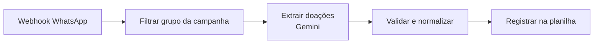

# Sorrisos em Ação

Automação em n8n que registra doações de uma campanha de caridade para crianças a partir das
mensagens enviadas no grupo de WhatsApp da campanha.

Uma mensagem como *"Recebi 3 brinquedos infantis e 2 agasalhos masculinos da Maria"* vira duas linhas
na planilha, com doador, categoria, quantidade, gênero, faixa etária e descrição. As organizadoras não
precisam mais copiar as doações à mão.

## Contexto

O projeto surgiu de um trabalho de Engenharia de Requisitos na UFAM, em 2026. Nele, uma equipe de seis
pessoas entrevistou as organizadoras de um grupo de caridade e elicitou os requisitos de um sistema de
gestão de itens, agenda e ações. Fiquei responsável pelos requisitos não funcionais e pelas regras
de negócio. Meses depois, construí sozinha esta automação para atender parte da gestão de itens.

## Como funciona



1. O provedor de API do WhatsApp envia cada mensagem do grupo para o webhook.
2. O filtro descarta mensagens de outros grupos ou conversas.
3. O Google Gemini interpreta o texto livre e devolve os itens em JSON.
4. Um nó de código confere cada item com as categorias permitidas e limpa os campos.
5. Cada item vira uma linha no Google Sheets.

Detalhes de cada etapa e das regras de classificação: [docs/arquitetura.md](docs/arquitetura.md).

## Estrutura do repositório

```
workflows/sorrisos-em-acao.json   Workflow do n8n, sanitizado
scripts/sanitize_workflows.py     Remove IDs e dados sensíveis dos exports do n8n
.githooks/pre-commit              Bloqueia commits com dados sensíveis nos workflows
samples/                          Exemplo de requisição e modelo da planilha (dados fictícios)
docs/                             Arquitetura, segurança e privacidade
docker-compose.yml                n8n local
.env.example                      Variáveis necessárias, sem valores
```

## Como executar

Requisitos: Docker, uma chave da API do Google Gemini, uma conta Google com a planilha e um
provedor de API do WhatsApp que envie webhooks.

1. Copie `.env.example` para `.env` e preencha os valores.
2. Suba o n8n com `docker compose up -d` e acesse `http://localhost:5678`.
3. Importe `workflows/sorrisos-em-acao.json` em *Workflows → Import from File*.
4. Crie as credenciais **Google Gemini (PaLM) API** e **Google Sheets OAuth2** e associe-as aos nós.
5. Crie a planilha com os cabeçalhos de `samples/planilha-modelo.csv`.
6. Teste localmente, com o workflow em modo de teste e `WHATSAPP_GROUP_ID` igual ao do exemplo:

   ```bash
   curl -X POST http://localhost:5678/webhook-test/whatsapp-api \
        -H "Content-Type: application/json" \
        -d @samples/webhook-exemplo.json
   ```

7. Para uso real, configure no provedor do WhatsApp a URL pública do webhook (`/webhook/whatsapp-api`).

## Segurança e privacidade

- Nenhuma credencial, ID real ou dado de doador está versionado. O workflow passa pelo script de
  sanitização, e o hook de pre-commit impede que isso mude por engano.
- A saída do modelo não é usada diretamente: ela é validada contra listas fixas no código. Os textos
  são limitados em tamanho e protegidos contra injeção de fórmulas na planilha.
- A planilha guarda só os dados da doação. O telefone e o texto original das mensagens não são gravados.

Riscos tratados e limitações conhecidas: [docs/seguranca.md](docs/seguranca.md).
Dados pessoais e LGPD: [docs/privacidade.md](docs/privacidade.md).

## Tecnologias

n8n · Google Gemini (via AI Agent do n8n) · Google Sheets · API de WhatsApp via webhook · JavaScript · Python

## Créditos

A estrutura inicial do workflow partiu de um template da comunidade n8n. Ela foi adaptada para o
domínio da campanha: regras de classificação, filtro de grupo, validação e mapeamento da planilha.

## Licença

[MIT](LICENSE)
