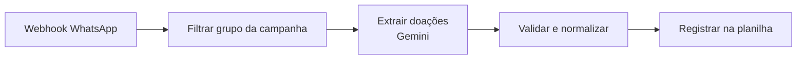

# Arquitetura

O sistema é um único workflow do n8n com cinco etapas em sequência.



## Etapas

| Nó | Tipo | Responsabilidade |
|----|------|------------------|
| Webhook WhatsApp | Webhook (POST `/whatsapp-api`) | Recebe cada mensagem enviada pelo provedor de API do WhatsApp |
| Filtrar grupo da campanha | Filter | Deixa passar apenas mensagens do grupo definido em `WHATSAPP_GROUP_ID` |
| Extrair doações (Gemini) | AI Agent + Google Gemini | Lê o texto livre e devolve um array JSON com uma entrada por tipo de item |
| Validar e normalizar | Code (JavaScript) | Converte a resposta em itens, descarta o que estiver fora das listas permitidas e limpa os textos |
| Registrar na planilha | Google Sheets (append) | Adiciona uma linha por item na planilha da campanha |

## Formato de entrada

O webhook espera o corpo no formato abaixo. Um exemplo completo está em `samples/webhook-exemplo.json`.

```json
{ "phone": "<id do grupo>", "text": { "message": "<texto da mensagem>" } }
```

## Classificação feita pelo modelo

As regras completas estão no system prompt do nó **Extrair doações (Gemini)**. Resumo:

| Campo | Valores permitidos |
|-------|--------------------|
| Categoria | Financeiro, Brinquedos, Roupas, Alimentos, Higiene |
| Gênero | Masculino, Feminino, Unissex, N/A |
| Faixa etária | Bebê (0-2 anos), Infantil (3-12 anos), Juvenil (13-17 anos), Adulto, Geral / N/A |

- Uma mensagem com vários tipos de item gera várias linhas.
- Doações financeiras têm `qtd_itens = 0` e o valor em reais.
- Quando o doador não é identificado, o registro usa "Anônimo" ou "Não informado".

## Por que a validação fica fora do modelo

O modelo recebe instruções para responder apenas com as categorias permitidas, mas isso não é garantia.
A etapa **Validar e normalizar** confere cada item com listas fixas no código. Assim, uma resposta
inesperada do modelo, por erro ou por manipulação da mensagem, não chega à planilha.

## Saída

As colunas da planilha estão em `samples/planilha-modelo.csv`:
`Doador, Data, Categoria, Valor_R$, Qtd_itens, Genero, Faixa_Etaria, Descricao, Status`.
